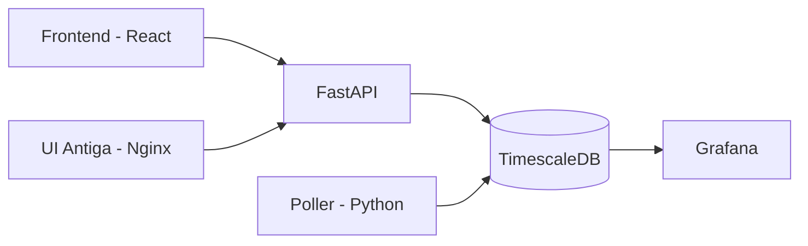
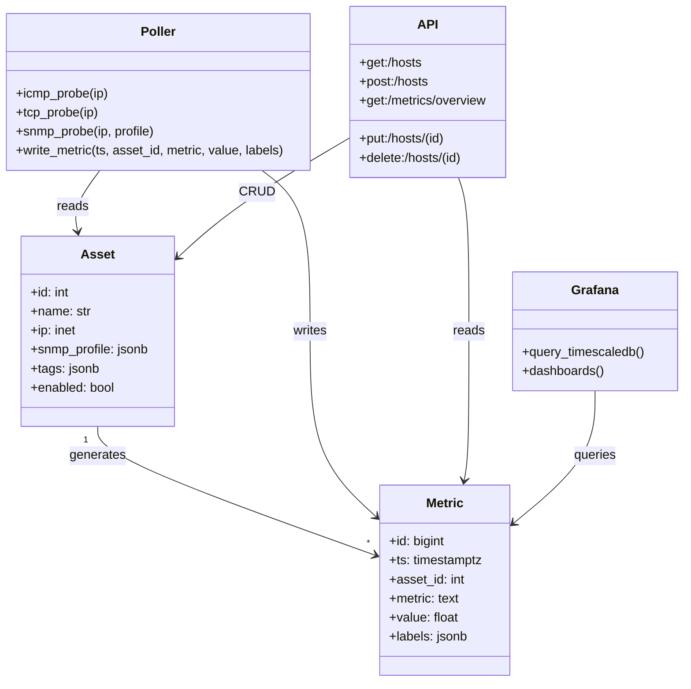
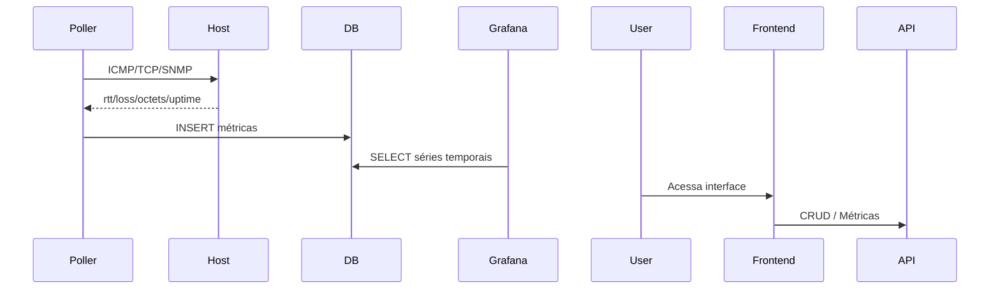

# **NetGuard**  
Plataforma Proativa de Monitoramento e Rastreabilidade de Incidentes em Redes Corporativas

---

## 🧩 Introdução

O **NetGuard** é uma plataforma completa de monitoramento, análise e rastreabilidade de incidentes em redes corporativas.  
Seu objetivo é fornecer **visibilidade contínua**, **telemetria avançada** e **coleta inteligente** de métricas utilizando protocolos essenciais como **ICMP**, **TCP** e **SNMP**.

Ele foi desenvolvido como um projeto acadêmico (TCC), mas com estrutura, modularidade e práticas de desenvolvimento adotadas na indústria — tornando o NetGuard um sistema real de observabilidade de rede.

---

## 🧠 Fundamentos do NetGuard

O sistema é construído sobre três pilares fundamentais:

| Pilar | Função |
|-------|--------|
| **Monitoramento ativo** | Sondas ICMP/TCP/SNMP para verificar disponibilidade e desempenho |
| **Armazenamento temporal** | Métricas salvas em TimescaleDB para análise histórica |
| **Visualização inteligente** | Dashboards Grafana para insights e tomada de decisão |

Esses pilares garantem um ecossistema robusto, escalável e adequado a redes modernas.

---

## ⚙️ Componentes Principais

### **1. Poller (ICMP/TCP/SNMP)**  
Responsável por realizar sondagens periódicas nos ativos da rede.  
Coleta:
- RTT (round-trip time)  
- Perda de pacotes  
- Status unificado do host  
- Leitura SNMP v2c de interfaces, com preferencia por ifHCInOctets/ifHCOutOctets e fallback para ifInOctets/ifOutOctets
- Health-check TCP  

### **2. API (FastAPI)**  
Expõe endpoints REST para:
- Gerenciar hosts  
- Consultar métricas  
- Integrar com frontends e dashboards  

### **3. TimescaleDB (PostgreSQL)**  
Armazena séries temporais com alta performance.

### **4. Interface Web (React + Tailwind)**  
Responsável pela visualização dos ativos, métricas e operações CRUD.

### **5. Grafana**  
Painéis avançados para análise em tempo real e histórico.

---

## 🧱 Arquitetura Geral



---

## 📊 Diagrama UML – Lógica do Sistema



---

## 🏗️ Estrutura do Projeto

```bash
netguard/
│
├── api/                   # API FastAPI
│   ├── main.py
│   ├── routers/
│   └── models/
│
├── poller/                # Poller ICMP/TCP/SNMP
│   ├── main.py
│   └── requirements.txt
│
├── netguard-frontend/     # Interface moderna (React)
│
├── ui/                    # Interface antiga (legado)
│
├── docker-compose.yml     # Orquestração dos serviços
└── README.md
```

---

## 🔁 Fluxo de Operação



---

## 🚀 Deploy com Docker

### **1. Clonar o repositório**
```bash
git clone https://github.com/rodrigomadureira/netguard.git
cd netguard
```

### **2. Subir ambiente**
```bash
docker compose up -d --build
```

No Windows, se o projeto estiver aberto por caminho UNC e o Compose nao inferir o nome do projeto, use:

```bash
docker compose -p netguard up -d --build
```

Para a entrega oficial na VM Linux `192.168.56.15`, use sempre o Docker Context SSH:

```powershell
docker --context netguard-vm compose -p netguard config --quiet
docker --context netguard-vm compose -p netguard up -d --build
docker --context netguard-vm compose -p netguard ps -a
```

Evite `docker compose ...` sem `--context netguard-vm`, pois isso executa no Docker Desktop local do Windows.

### Housekeeper, alertas de silencio e instalador

O NetGuard possui um housekeeper proprio para limpeza periodica de dados antigos, configurado por variaveis `RETENTION_*_DAYS`.
Tambem gera incidentes/alertas quando ICMP, SNMP ou syslog param de chegar para um host esperado.

Detalhes operacionais:

- `docs/retencao-alertas-capacidade.md`
- `GET /housekeeper/status`
- `installer/windows/NetGuardInstaller.ps1`
- `installer/windows/build-installer.ps1`

### **3. Endpoints**
| Serviço | URL |
|--------|-----|
| Acesso oficial HTTPS | https://netguard.local/ |
| API via HTTPS | https://netguard.local/api |
| Grafana via HTTPS | https://netguard.local/grafana/ |
| Frontend direto para debug | https://IP:8081 |
| UI antiga | http://IP:3100 |
| API direta para debug | http://IP:8000 |
| Grafana direto para debug | http://IP:3000 |
| Banco | localhost:5432 |

---

## Validação final para TCC

O roteiro consolidado de validação está em [`docs/validacao-final-netguard.md`](docs/validacao-final-netguard.md). Ele cobre:

- arquitetura e serviços Docker;
- variáveis de ambiente e `.env.example`;
- healthchecks `/health` e `/health/deep`;
- validação de API, frontend, coleta, SNMP, syslog, incidentes e alertas;
- checklist de prints/evidências para o TCC;
- limitações reais do MVP e próximos trabalhos.

Documentos complementares:

- [`docs/docker-context-vm.md`](docs/docker-context-vm.md): configuracao do Docker Context SSH para a VM.
- [`docs/https-netguard.md`](docs/https-netguard.md): reverse proxy HTTPS com Caddy, certificados locais e validacao.
- [`docs/commercial-parity-roadmap.md`](docs/commercial-parity-roadmap.md): matriz de paridade com Zabbix/SolarWinds.
- [`docs/arquitetura-netguard.md`](docs/arquitetura-netguard.md): arquitetura tecnica.
- [`docs/operacao-netguard.md`](docs/operacao-netguard.md): rotina operacional.
- [`docs/evidencias-tcc.md`](docs/evidencias-tcc.md): checklist de evidencias.

Atualizacao da VM em 2026-05-08: o acesso oficial e `https://netguard.local/`, com API em `/api`, Grafana em `/grafana/` e HTTP redirecionando para HTTPS. As portas diretas antigas ficaram apenas para debug.

Para preservar dados, não use `docker compose down -v` durante a validação. Segredos reais devem ficar fora do Git.

Resultado local de 2026-04-27: o ambiente foi validado com `docker compose -p netguard up -d --build`; API, banco e web ficaram saudáveis; endpoints principais responderam HTTP 200; migrations foram idempotentes; build Vite do frontend e testes Python passaram. A interface web responde por HTTPS em `https://localhost:8081`, usando certificado autoassinado para o MVP local. Pendências reais: não há script `npm test` e o `npm audit` ainda reporta vulnerabilidades transitivas.

---

## Módulo de Alertas

O NetGuard possui um serviço desacoplado de alertas (`AlertService`) que pode ser chamado pela API ou futuramente por coletores SNMP, Zabbix, ping, syslog, análise de vulnerabilidades ou outros motores de detecção.

### Variáveis de ambiente

```bash
ALERT_EMAIL_ENABLED=true
SMTP_HOST=smtp.exemplo.local
SMTP_PORT=587
SMTP_USER=usuario
SMTP_PASSWORD=
SMTP_FROM=netguard@exemplo.local
ALERT_EMAIL_TO=noc@exemplo.local

ALERT_WEBHOOK_ENABLED=true
WEBHOOK_PROVIDER=discord # discord ou telegram
DISCORD_WEBHOOK_URL=
TELEGRAM_BOT_TOKEN=
TELEGRAM_CHAT_ID=
TELEGRAM_PARSE_MODE=
NETGUARD_PUBLIC_URL=https://192.168.56.15
NETGUARD_ALERT_TIMEZONE=America/Sao_Paulo
```

Não coloque senhas, tokens ou URLs reais no código. Use variáveis de ambiente no `docker-compose.yml`, em um arquivo `.env` ou no ambiente do serviço.

### Teste de alerta

Endpoint:

```bash
POST /alerts/test
```

Exemplo com `curl`:

```bash
curl -X POST http://localhost:8000/alerts/test \
  -H "Content-Type: application/json" \
  -d '{
    "device_name": "Switch-Core-01",
    "device_ip": "192.168.0.10",
    "problem_type": "INTERFACE_DOWN",
    "description": "Interface Gi1/0/24 indisponível",
    "severity": "HIGH"
  }'
```

O mesmo payload também pode ser enviado para `POST /alerts` por integrações externas.

### Mensagem recebida

```text
[NetGuard] Problema: INTERFACE_DOWN

🚨 Problema detectado: INTERFACE_DOWN

🖥️ Host: Switch-Core-01
🌐 IP: 192.168.0.10
👥 Grupo: Sem grupo
📍 Item: INTERFACE_DOWN
❗ Trigger: INTERFACE_DOWN
📊 Valor: Down (0)
🕒 Início: 2026.04.27 às 09:00:00
📌 Gravidade: Alta 🔥

🔗 Acesse: https://192.168.56.15/monitoring/alerts?incident_id=358
```

Cada canal pode sobrescrever o corpo da mensagem com templates em estilo Markdown usando placeholders como `{device_name}`, `{device_ip}`, `{group_name}`, `{problem_name}`, `{summary}`, `{impact}`, `{action}`, `{evidence_summary}`, `{affected_context}`, `{problem_type}`, `{item}`, `{value}`, `{severity_label}`, `{started_at}`, `{resolved_at}`, `{duration}` e `{incident_url}`.

### Regra anti-spam

Se já existir um incidente aberto para o mesmo `device_ip` e `problem_type` nos últimos 10 minutos, o NetGuard não envia uma nova notificação. Nesse caso, apenas atualiza `last_detected_at`/`last_seen_at`.

Se o problema for novo ou o último registro aberto tiver mais de 10 minutos, o serviço atualiza o incidente e tenta enviar novamente pelos canais habilitados.

### Resolução

Para marcar um incidente como resolvido:

```bash
curl -X POST http://localhost:8000/incidents/1/resolve \
  -H "Content-Type: application/json" \
  -d '{"send_recovery_notification": true}'
```

Quando resolvido, o status passa para `RESOLVED`, `resolved_at` é preenchido e a notificação de recuperação é enviada por padrão. Para apenas resolver sem enviar recuperação, use `send_recovery_notification: false`.

### Alertas automáticos de sinais

O serviço `anomaly-to-incident` também publica automaticamente no `AlertService` os sinais recentes que aparecem em **Monitoramento > Sinais recentes**:

- eventos de syslog, como storm control, MAC flapping, loop, STP e flap de interface;
- incidentes promovidos por correlação, como `LOOP_RISK` e `EARLY_WARNING`;
- previsões/anomalias de `anomaly_scores` acima do limiar configurado;
- recuperações de incidentes resolvidos recentemente, quando ainda não existe envio de recuperação registrado.

Variáveis principais do bridge automático:

```bash
SIGNAL_ALERTS_ENABLED=true
SYSLOG_ALERTS_ENABLED=true
SYSLOG_ALERT_MIN_SEVERITY=info
SYSLOG_ALERT_INTERFACE_FLAP_ENABLED=true
SYSLOG_ALERT_INTERFACE_FLAP_MIN_EVENTS=4
SYSLOG_ALERT_INTERFACE_FLAP_WINDOW_SEC=120
SYSLOG_ALERT_INTERFACE_FLAP_MIN_SEVERITY=notice
PREDICTION_ALERTS_ENABLED=true
PREDICTION_ALERT_MIN_SCORE=0.50
PREDICTION_ALERT_TOP_ITEMS=5
SIGNAL_ALERT_LOOKBACK_SEC=120
SIGNAL_ALERT_CACHE_TTL_SEC=600
ALERT_NOTIFY_RECOVERIES_ENABLED=true
AUTO_RESOLVE_ALERTS_ENABLED=true
AUTO_RESOLVE_AFTER_MINUTES=5
```

O cache local de `SIGNAL_ALERT_CACHE_TTL_SEC` reduz chamadas repetidas ao `AlertService`; a regra definitiva anti-spam continua sendo aplicada no banco por `device_ip` + `problem_type` em janela de 10 minutos. Previsões são agrupadas por host em um único alerta com os principais itens, em vez de uma mensagem por métrica. Previsões antigas de baixa severidade que ficaram pendentes não são reenviadas pelo varredor. Eventos de interface `up` são tratados como recuperação de incidente aberto, não como novo problema. Para demonstrar previsões de baixa pontuação no laboratório, reduza `PREDICTION_ALERT_MIN_SCORE` para `0.25` ou `0.0`.

---

### Configuração de canais de alerta

A interface web possui a tela **Monitoramento > Alertas**, onde é possível cadastrar canais de notificação por E-mail, Telegram, Discord, Slack, Microsoft Teams, Google Chat, Mattermost, Rocket.Chat, Pushover e Webhook genérico.

Cada canal possui nome, tipo (`email`, `telegram`, `discord`, `slack`, `msteams`, `google_chat`, `mattermost`, `rocketchat`, `pushover` ou `webhook`), estado ativo/inativo, severidade mínima (`LOW`, `MEDIUM`, `HIGH`, `CRITICAL`) e configuração específica em JSONB no banco.

Campos sensíveis como senha SMTP, webhooks, tokens, user keys e headers são mascarados ao retornar pela API. Se o usuário mantiver o valor mascarado na edição, o backend preserva o segredo já salvo.

Fallback por ambiente continua disponível. Se não houver nenhum canal cadastrado em `alert_channels`, o `AlertService` usa as variáveis `ALERT_EMAIL_ENABLED`, `ALERT_WEBHOOK_ENABLED`, `SMTP_*`, `DISCORD_WEBHOOK_URL`, `TELEGRAM_BOT_TOKEN` e `TELEGRAM_CHAT_ID`. Se houver canais cadastrados, apenas os canais ativos e compatíveis com a severidade mínima são considerados.

Endpoints principais:

```bash
GET    /alerts/channels
POST   /alerts/channels
PUT    /alerts/channels/{channel_id}
PATCH  /alerts/channels/{channel_id}/toggle
DELETE /alerts/channels/{channel_id}
POST   /alerts/channels/{channel_id}/test
```

Guia completo de configuração: `docs/canais-alerta-netguard.md`.

Exemplo de canal Discord sem credencial real:

```bash
curl -X POST http://localhost:8000/alerts/channels \
  -H "Content-Type: application/json" \
  -d '{
    "name": "Discord NOC",
    "provider": "discord",
    "enabled": true,
    "min_severity": "HIGH",
    "config": {
      "webhook_url": ""
    }
  }'
```

### Validação do módulo de alertas

Rebuild da API:

```bash
docker compose up -d --build api web anomaly-to-incident
```

Teste de alerta:

```bash
curl -i -X POST http://localhost:8000/alerts/test \
  -H "Content-Type: application/json" \
  -d '{
    "device_name": "Switch-Core-01",
    "device_ip": "192.168.0.10",
    "problem_type": "INTERFACE_DOWN",
    "description": "Interface Gi1/0/24 indisponível",
    "severity": "HIGH"
  }'
```

Consulta geral dos últimos incidentes:

```sql
SELECT id, device_name, device_ip, problem_type, severity, status, notification_sent
FROM incidents
ORDER BY updated_at DESC
LIMIT 5;
```

Consulta corrigida por IP:

```sql
SELECT id, device_name, device_ip, problem_type, severity, status, notification_sent, updated_at
FROM incidents
WHERE split_part(device_ip::text, '/', 1) = '192.168.0.10'
  AND problem_type = 'INTERFACE_DOWN'
ORDER BY updated_at DESC;
```

Histórico de notificações:

```sql
SELECT id, incident_id, channel, provider, delivery_status, error, sent_at
FROM incident_notifications
ORDER BY sent_at DESC
LIMIT 10;
```

Logs da API:

```bash
docker compose logs api --tail=100
```

Regra anti-spam: se o mesmo `device_ip` e `problem_type` já tiver incidente ativo (`open` ou `acknowledged`, em maiúsculo ou minúsculo) nos últimos 10 minutos, o NetGuard atualiza a última detecção e registra a supressão em `incident_notifications` com `provider=anti_spam` e `delivery_status=suppressed`.

---

## 🧱 Conclusões

- O NetGuard se consolida como uma solução completa de **monitoramento de rede**.  
- Combina ICMP, TCP e SNMP de maneira eficiente e extensível.  
- A arquitetura modular facilita evolução, integração e escalabilidade.  
- A utilização de TimescaleDB e Grafana eleva o nível de análise e observabilidade.  
- O sistema está preparado para aplicações acadêmicas e ambientes reais.

---

## 📚 Referências

- Grafana Labs — Observability Stack  
- TimescaleDB Documentation  
- RFC 1157 — Simple Network Management Protocol (SNMP)  
- Pressman, R. — *Engenharia de Software*  
- Sommerville, I. — *Software Engineering*  
- Gabriel Lara Baptista — *Arquitetura de Software, FESA*  
- Refactoring.Guru — *Design Patterns*
## Fechamento TCC 2026-05-20

Rodada atual reforcou autenticacao, RBAC, auditoria, service token dos workers, IA operacional rapida e estabilidade de workers durante startup do banco.

Ambiente oficial de validacao: VM Linux `192.168.56.15`.

Documentos principais:

- `docs/relatorio-tecnico-tcc-final.md`
- `docs/validacao-final-netguard.md`
- `docs/operacao-netguard.md`
- `docs/commercial-parity-roadmap.md`

Rotas internas exigem login. Perfis atuais: `admin`, `operator`, `viewer` e `auditor`. No banco validado em 2026-05-20, `admin@netguard.local` autenticou com `123456`; em banco novo, ajuste `NETGUARD_DEFAULT_USER_PASSWORD` no `.env` antes de subir.
